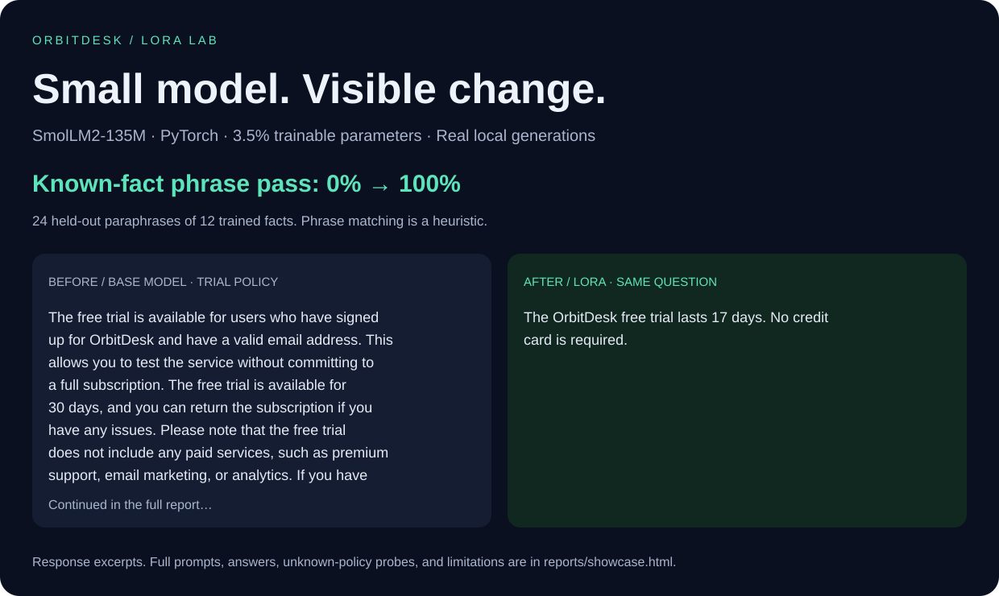

# OrbitDesk LoRA Lab

**Fine-tune a small language model on a laptop. Inspect what actually changed.**

An end-to-end PyTorch project that adapts **SmolLM2-135M-Instruct** to a fictional SaaS product's policies using **LoRA**. It includes a readable training loop, synthetic data, held-out evaluation, a visual before/after dashboard, and an optional QLoRA configuration.

This repository is an educational portfolio experiment. The claims are deliberately narrow: learning twelve facts and reproducing them under new question wording. OrbitDesk is fictional.



## Start with the evidence

The completed RTX 4050 run took **9.8 minutes**, used **930 MB peak PyTorch-allocated VRAM**, and trained **3.50%** of the combined model's parameters. The best validation checkpoint was epoch 11.

| Held-out probe | Base model | With LoRA |
|---|---:|---:|
| Required phrases for known policies | 0 / 24 | 24 / 24 |
| Explicit abstention for unknown policies | 0 / 4 | 4 / 4 |

These are small synthetic recall and abstention probes, not general LLM accuracy. Every adapted response matched its reference in this run; that does not establish robustness to arbitrary prompts.

- Open [the visual experiment report](reports/showcase.html) in a browser; it requires no Python or GPU.
- Read [the measured results](reports/RESULTS.md), including failures and limitations.
- Explore [all raw answers](reports/results.json). No responses are fabricated for the demo.
- Review [the local validation record](docs/VALIDATION.md).
- Follow [the learning walkthrough](docs/WALKTHROUGH.md), then inspect [the PyTorch training loop](src/orbitlab/train.py).

## Run locally (Windows PowerShell)

Tested environment and hardware are recorded in the report. Python 3.13 is used locally; Python 3.11+ is supported by the project metadata but other versions have not been locally tested.

```powershell
python -m venv .venv
# Activation is optional; using the executable directly avoids execution-policy issues.
.\.venv\Scripts\python.exe -m pip install --upgrade pip
.\.venv\Scripts\python.exe -m pip install torch==2.8.0 --index-url https://download.pytorch.org/whl/cu128
.\.venv\Scripts\python.exe -m pip install -r requirements.txt
.\.venv\Scripts\python.exe -m pip install -e . --no-deps
.\.venv\Scripts\python.exe -m orbitlab.doctor
.\.venv\Scripts\python.exe -m pytest -q
.\.venv\Scripts\python.exe -m streamlit run app.py --server.address 127.0.0.1
```

The dashboard immediately displays committed results. Its live prompt tab also needs the locally trained adapter. This development folder already has one after the completed local run; a fresh clone needs training.

After installation, Windows users can double-click **Launch-Demo.cmd** to start the dashboard at `http://127.0.0.1:8501/`. Keep its terminal window open while using the dashboard. This address works only while that local server is running; start the launcher again after closing it or restarting the computer. The [portable report](reports/showcase.html) opens directly from disk without a server.

You can also compare a new question from the terminal:

```powershell
.\.venv\Scripts\python.exe -m orbitlab.chat "How long can I recover a deleted OrbitDesk project?"
```

For a CPU-only environment, install PyTorch from `https://download.pytorch.org/whl/cpu` instead. On Linux/macOS, replace `.\.venv\Scripts\python.exe` with `.venv/bin/python`. CPU LoRA uses float32 and is slower. This project does not implement Apple MPS.

## Reproduce the experiment

The first run downloads roughly 270 MB of base weights, plus tokenizer files; the CUDA PyTorch installation is several GB. No API key, cloud training, or paid service is needed. Internet is required for initial dependencies, model loading, and training revision resolution.

```powershell
# Data is committed; regeneration is deterministic and optional.
.\.venv\Scripts\python.exe -m orbitlab.data
# Use a new directory for every run; existing runs are never overwritten.
.\.venv\Scripts\python.exe -m orbitlab.train --output outputs/my-run
.\.venv\Scripts\python.exe -m orbitlab.evaluate --run outputs/my-run --output reports/my-run/results.json
.\.venv\Scripts\python.exe -m orbitlab.report --results reports/my-run/results.json --run outputs/my-run
```

The published run uses `outputs/lora` and `reports/results.json`. To replace dashboard evidence intentionally, evaluate into `reports/results.json`, then run `python -m orbitlab.report`. The live tab uses `outputs/lora`; keep that adapter and the published report from the same run.

Training selects the lowest **validation** loss. The test set is used only after training. Fixed seeds improve repeatability but GPU kernels and platform differences can still change results. The run records an immutable model commit, data hashes, package versions, parameter counts, duration, and peak allocated VRAM.

Both configurations pin the original experiment's model revision. `reports/requirements-lock.txt` records the complete Windows environment; the CUDA wheel in that file requires the PyTorch CUDA index above. It is an environment snapshot, not a cross-platform lockfile. Follow the pinned direct dependencies in `requirements.txt` for the standard installation.

## Why this model and LoRA?

The [SmolLM2 model card](https://huggingface.co/HuggingFaceTB/SmolLM2-135M-Instruct) identifies the 135M model as a compact instruction model under Apache 2.0. It is small enough to make this experiment accessible. LoRA adds trainable low-rank matrices to frozen linear layers; see the [original paper](https://arxiv.org/abs/2106.09685) and [PEFT documentation](https://huggingface.co/docs/peft/developer_guides/lora).

At this model size, plain LoRA fits the available RTX 4050 and avoids quantization complexity. Optional **QLoRA** freezes a four-bit NF4 base with double quantization and trains adapters; see [QLoRA](https://arxiv.org/abs/2305.14314) and [PEFT's quantization guide](https://huggingface.co/docs/peft/developer_guides/quantization). It can save base-weight memory, but speedups are not guaranteed and quantization changes the numerical baseline.

```powershell
.\.venv\Scripts\python.exe -m pip install bitsandbytes==0.48.1
.\.venv\Scripts\python.exe -m orbitlab.train --config configs/qlora.json --output outputs/qlora
.\.venv\Scripts\python.exe -m orbitlab.evaluate --run outputs/qlora --output reports/qlora/results.json
```

QLoRA is an optional implementation and has not been validated in the published run. Its availability depends on the local CUDA/bitsandbytes build. Compare a quantized baseline to the quantized adapted model, which this evaluator does automatically.

## Repository map

| Location | Purpose |
|---|---|
| `data/` | Fictional knowledge source and explicit train/validation/test records |
| `configs/` | Small, reviewable experiment configurations |
| `src/orbitlab/data.py` | Deterministic data creation; no external data collection |
| `src/orbitlab/model.py` | Shared loading, chat template, assistant masking, generation |
| `src/orbitlab/train.py` | PyTorch loop, AdamW, accumulation, clipping, validation |
| `src/orbitlab/evaluate.py` | Matched baseline and adapter inference; phrase rubric |
| `src/orbitlab/report.py` | Portable visual report from actual outputs |
| `app.py` | Streamlit comparison, learning view, local live inference |
| `reports/` | Small, versionable evidence; all test outputs |
| `docs/` | Walkthrough, model card, dataset card, presentation guide |
| `tests/` | Leakage, masking, scoring, and UI checks |
| `outputs/` | Local adapter artifacts, ignored by Git |

## What you can explain in an interview

“I built an experiment that freezes a small pretrained language model and trains LoRA adapters using assistant-only supervised loss. I controlled the before/after comparison, separated validation from testing, recorded provenance, and inspected both recall gains and abstention failures. The test measures new wording of trained facts, not new knowledge or broad reasoning.”

See [the five-minute presentation guide](docs/PRESENTATION.md). Run the experiments yourself and describe the parts you understand; this is a learning project, not proof of prior professional experience.

## Scope and limitations

- Synthetic and highly repetitive data makes this an intentionally easy learning problem.
- The same facts appear in every split; only question wording is held out. The 24 known-fact questions are correlated, not 24 independent facts.
- Phrase matching can accept a contradictory answer or reject a valid paraphrase. Inspect raw text; do not call this score general accuracy.
- The four unknown-policy questions are a small probe, not a safety benchmark. Fine-tuning can increase confident hallucination.
- General-purpose capability retention has not been benchmarked. Low training loss is not proof of useful generalization.
- For frequently changing factual knowledge, prefer retrieval-augmented generation (RAG), or combine retrieval with fine-tuned behavior.
- Do not deploy this synthetic support model as a real product assistant.

Code and authored synthetic data: MIT. Base model: Apache 2.0; retain upstream attribution when distributing derived weights. No base weights or adapter binaries are committed.

## Publish as your own repository

This folder is an independent Git repository. Create an empty remote repository, then connect and push it:

```powershell
git remote add origin YOUR_REPOSITORY_URL
git push -u origin main
```

The virtual environment and local weights stay out of Git. The small dataset, report, preview image, and raw evaluation evidence are included. Review the walkthrough and presentation guide before presenting the experiment.
