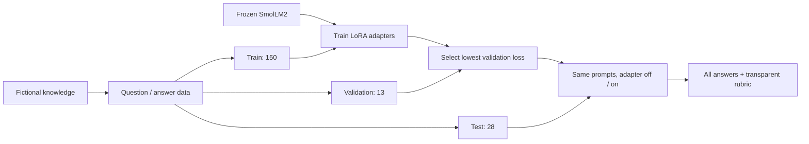

# Learn the process by following one example



The test branch never feeds checkpoint selection. Known facts are shared across the splits; question templates differ.

## 1. Define a testable behavior

We want an assistant to know that the fictional OrbitDesk trial lasts **17 days** and needs **no credit card**. The pretrained model has no authoritative source for this invented policy. During inference, both versions receive the same generic support-assistant system prompt; it contains no policy answers.

Start in `data/knowledge.md`. This is our source of truth. `data/train.jsonl` converts the source into supervised question/answer pairs. Every record also has an ID, fact group, and phrase-based scoring rubric.

The split is deliberate: 150 training examples, 13 validation examples, and 28 test examples. Training and test questions do not match exactly, but known facts do overlap. This evaluates recall under paraphrasing. A fact-held-out split would instead test behavior on facts that training never taught, which is a different question.

## 2. Turn conversations into tokens

Read `model.encode`. The tokenizer's chat template inserts role markers around the system message, question, and answer. The model sees all these tokens, but the label for every prompt token is **-100**. PyTorch cross entropy ignores that value. Padding is also -100, while genuine end-of-answer tokens remain supervised even when EOS and padding share an ID.

For intuition:

```text
Input:   [system ...] [user: trial?] [assistant: 17 days ...] [EOS]
Labels:  [-100  ...] [-100 ......] [           17 days ...] [EOS]
```

The causal language model internally shifts predictions and labels by one token: it predicts the next token from preceding tokens. We fail on overlong examples instead of silently removing the answer.

## 3. Understand what LoRA changes

A normal dense layer multiplies an input by a matrix W. Full fine-tuning changes W itself. LoRA freezes W and learns two smaller matrices A and B:

```text
output = W x + (alpha / rank) B A x
```

For a layer with input dimension d and output dimension k, the original matrix has k*d parameters; the adapter has r*(d+k). Rank r limits the dimension of the learned update. Here r=16 and alpha=32, so the update scale is 2. The adapters target attention projections and feed-forward projections. Their parameter count is measured, not guessed.

The adapter is an additional set of weights, not a database lookup and not an extra prompt. `model.disable_adapter()` removes its contribution, giving us the frozen baseline in the exact same model object.

## 4. Read the training loop

Open `train.py` and follow these steps:

1. Resolve the model repository to an immutable revision; seed Python and PyTorch.
2. Load the base and attach adapters through PEFT. Only adapter parameters require gradients.
3. Form padded batches of four examples. Two microbatches contribute to each optimizer update, an effective batch of eight except the last partial group.
4. Compute cross entropy on assistant tokens. Backpropagate a scaled microbatch loss.
5. Clip the gradient norm to 1.0, update with AdamW, and advance the warmup/decay schedule.
6. Measure token-weighted validation loss without dropout or gradients.
7. Save the adapter only when validation loss improves.

The optimizer averages microbatch losses; because answer lengths differ, this is not exactly the same as a single globally token-weighted large batch. Reported losses are token-weighted for clarity. There is no checkpoint resume in this intentionally small loop; restart with a new output directory.

## 5. Interpret the configuration

| Setting | Meaning | Typical tradeoff |
|---|---|---|
| learning_rate = 0.0005 | Size of adapter updates | Too high destabilizes; too low learns slowly |
| epochs = 12 | Full passes through the training examples | More passes can memorize or overfit |
| rank = 16 | Adapter update capacity | Higher rank costs memory and may overfit |
| dropout = 0.05 | Randomly drops adapter inputs during training | A modest regularizer on tiny data |
| max_length = 256 | Maximum tokenized example length | Longer sequences consume more memory |
| batch_size = 4 | Examples per forward/backward pass | Lower this first if GPU memory is exhausted |
| gradient_accumulation = 2 | Microbatches per update | Allows larger effective batches without matching peak activation memory |

LoRA reduces trainable weights and optimizer state. It does not eliminate memory for the base model, intermediate activations, or gradients flowing through layers. QLoRA additionally compresses the frozen base weights to four bits. This project uses bf16 on compatible CUDA devices and float32 otherwise; four-bit storage does not mean four-bit arithmetic everywhere.

## 6. Evaluate without moving the goalposts

The best checkpoint is chosen from validation loss, then evaluated on all 28 test prompts. Both sides use greedy decoding and the same maximum number of generated tokens. A known-fact case passes if all required phrases occur with word boundaries. Unknown cases pass only if the phrase “do not know” appears.

This scorer is transparent but imperfect. “I do not know, but the answer is Bitcoin” could pass the abstention rubric while hallucinating. Human review of the raw generations remains necessary. Do not tune repeatedly on the test set and still claim it is held out; use validation for revisions and create a new untouched test set for a final study.

Read the report's failed cases as carefully as successful ones. The baseline can already know how to write support responses. The meaningful change here is product-specific recall, not fluent English itself.

## 7. Explain the result visually

Open `reports/showcase.html` or launch the Streamlit dashboard. Pick a known policy and read the two complete answers. Then pick an unknown policy and discuss what went wrong. Inspect the loss curve alongside held-out generations: lowering loss and improving reliability are related but different objectives.

## 8. Extend it as your own experiment

- Change one variable at a time: rank 8 versus 16, or learning rate 0.0002 versus 0.0005.
- Add genuinely varied human-written questions; hold out a different set of paraphrases before training.
- Add separate multi-policy, contradiction, and general-capability tests. Do not combine them into a single opaque score.
- Compare against a baseline that includes the source knowledge in its prompt. That asks whether training is necessary at all.
- Build retrieval for changing documents; fine-tune the response style only if the baseline needs it.
- Run QLoRA separately and compare both memory and quality to LoRA using matched precision baselines.

Record failures, training time, dataset provenance, and hardware. A reproducible result with clear limits is more persuasive than a polished demo that hides its errors.

## Troubleshooting

For quick reference: a **token** is a piece of text, an **epoch** is one pass through the training data, a **batch** is a group of examples processed together, a **gradient** tells the optimizer how a parameter affects loss, an **adapter** is the small set of learned LoRA weights, and a **checkpoint** is a saved model state. A lower **loss** means the model assigns higher probability to the reference answers; it does not guarantee that new answers are correct.

- **CUDA is false:** run `python -m orbitlab.doctor`. Verify the venv interpreter and CUDA PyTorch wheel. A driver must support the chosen wheel; installing the standalone CUDA toolkit is not required for this wheel.
- **Out of memory:** close GPU-heavy apps or reduce `batch_size` to 1 and increase accumulation. Do not change test prompts to make evaluation easier.
- **PowerShell activation blocked:** use the direct `.venv\Scripts\python.exe` commands in the README.
- **Slow CPU:** use `--device cpu`; expect longer runs. Try `--epochs 1 --output outputs/smoke` for a functional check, not portfolio metrics.
- **Download failures:** retry after restoring connectivity. Models are cached by Hugging Face outside the repo; do not publish credentials.
- **QLoRA import failure:** install the optional pinned bitsandbytes package, confirm CUDA, or use the tested plain LoRA path.
- **Existing output directory:** choose another name. This preserves experiment evidence.
- **Changed dataset hash during evaluation:** evaluate with the original committed data or train a new run. Do not edit the hash to bypass the check.
